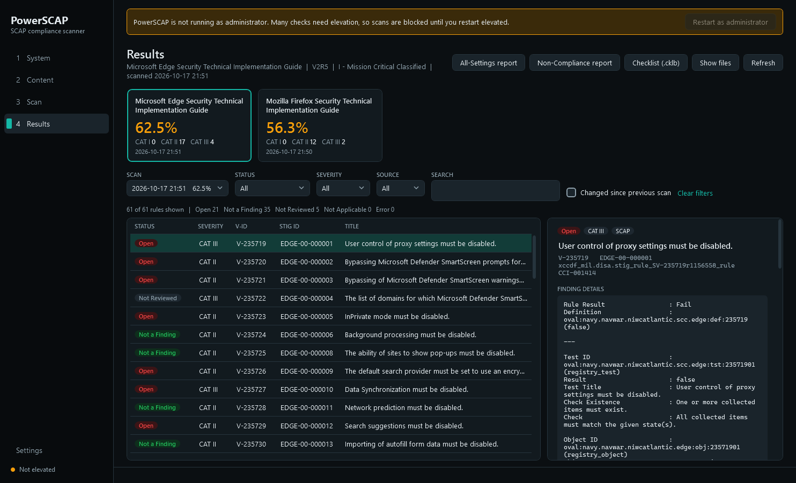
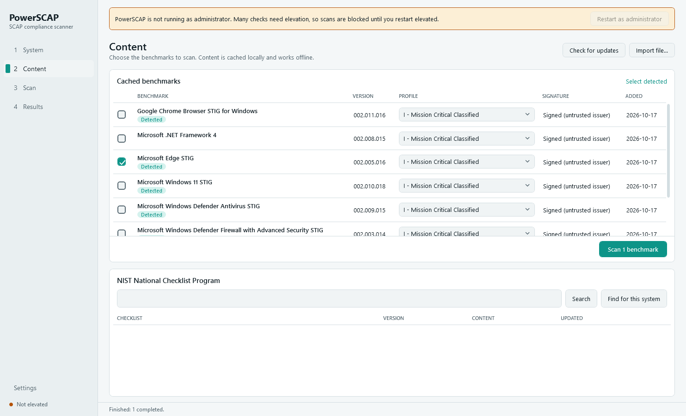

# PowerSCAP

[](https://github.com/digital-dev/PowerSCAP/actions/workflows/ci.yml)
[](LICENSE)


**A free, open-source SCAP compliance scanner for Windows.** PowerSCAP is an alternative to DISA's SCAP
Compliance Checker (SCC) that you can read end to end. It scans the local machine against DISA STIG benchmarks
and writes SCC-style HTML reports, STIG Viewer `.cklb` checklists and standard XCCDF / OVAL / ARF results.
It runs on what ships with Windows: Windows PowerShell 5.1, C# compiled at run time, and a WPF desktop app.
There is nothing to install, no service, no telemetry, and it never changes the system it scans.



Two rules drive the project:

- **Results must match a validated scanner 1:1.** SCAP is black and white. Every difference from SCC is
  investigated and written up in [docs/parity.md](docs/parity.md). In a paired run (SCC 5.15 and PowerSCAP back to
  back on the same machine, same content), all 245 rules of six benchmarks and all four XCCDF scores match. Windows 11
  could not be paired because SCC crashed on every attempt; against SCC's last complete Windows 11 run, every
  difference is a setting that changed on the machine between the scans.
- **Remove human error wherever possible.** PowerSCAP finds which benchmarks apply, downloads and verifies them,
  and puts the expected and collected values next to every finding. You don't have to interpret raw OVAL.

## Features

- **SCAP 1.2-1.4 data streams:** XCCDF 1.2 and OVAL 5.11.2, with profiles, CPE applicability, complex checks,
  the four standard scoring models and every OVAL object type the DISA and NIWC Windows benchmarks use.
- **Content from NIST's National Checklist Program:**
  - It finds the benchmarks for the products installed on this machine ([what it detects](#what-it-detects)).
  - It prefers NIWC enhanced SCAP 1.4 content, with DISA SCAP 1.3 as the fallback.
  - Every file's XML signature is checked.
  - Content is kept in a versioned local cache that works offline.
  - It detects new releases and imports local zips.
- **Beyond SCAP, never mixed with it:** the rules the content leaves to a person ([review layers](#review-layers)).
  - PowerSCAP's own native checks decide the ones a script can decide, following each STIG's check text.
  - The app asks you about the rest, using the content's own questions, and remembers your answers.
  - A separate STIG completeness score. SCAP results and scores never change.
- **Outputs:**
  - All-Settings and Non-Compliance HTML reports modeled on SCC's.
  - STIG Viewer 3 checklists (`.cklb`).
  - XCCDF 1.2 results, OVAL 5.11 results and ARF 1.1.
  - A summary page across benchmarks.
- **Desktop app:**
  - Dark, light or follow-Windows themes.
  - Background scans with progress and cancel.
  - A score tile per benchmark and a findings list you can filter.
  - Rule detail with expected vs. collected values, and an answer box for manual rules.
  - Scan history with "changed since previous scan".
  - A read-only checklist view for any `.cklb`, including SCC's and STIG Viewer's.
- **Fast and stable:** all seven benchmarks for a typical Windows 11 workstation scan in about a minute and a half.
  File and registry trees are read once per scan, however many checks walk them. In the paired run on the reference
  machine, PowerSCAP scanned six benchmarks in under 30 seconds; SCC 5.15 took about 11 minutes for the same six
  (counting only its successful attempts) and crashed on Windows 11 every time.
- **No script execution while scanning:** some SCAP content embeds PowerShell or cmd commands. PowerSCAP answers
  each of them in native C# instead of starting a shell, so a scan launches no PowerShell or cmd processes for
  antivirus to flag ([why](CODEBASE_MAP.md#no-script-execution)).
- **Read-only:** PowerSCAP reports and never remediates.

## Quick start

Requirements: Windows 10 or 11 with Windows PowerShell 5.1 (included in Windows). It is developed and tested on
Windows 11. Windows Server should work but has not been tested.
Scans need an elevated session.

```powershell
git clone https://github.com/digital-dev/PowerSCAP.git
cd PowerSCAP
Import-Module .\src\PowerSCAP

New-PowerScapShortcut            # desktop shortcut: opens the app as administrator, no console window
```

Or open the app from the elevated PowerShell window with `Start-PowerScapGui`.

The first import compiles the engine. That takes a few seconds, and the result is cached in
`%LOCALAPPDATA%\PowerSCAP\bin` until the source changes.

### From the command line

```powershell
Import-Module .\src\PowerSCAP
Find-PowerScapBenchmark -MatchSystem | Save-PowerScapBenchmark
Get-PowerScapBenchmark -Latest | Invoke-PowerScapScan -OutputPath D:\PowerSCAP-Results
```

| Command | What it does |
|---|---|
| `Get-PowerScapSystemProfile` | The OS and the STIG-relevant products installed on this machine |
| `Find-PowerScapBenchmark [-Keyword] [-MatchSystem]` | Searches NIST NCP for checklists with Windows SCAP content |
| `Save-PowerScapBenchmark` | Downloads a checklist into the cache. Older versions are kept |
| `Import-PowerScapBenchmark -Path` | Adds a local SCAP zip or data stream to the cache |
| `Get-PowerScapBenchmark [-Latest]` | Lists cached content (offline) |
| `Test-PowerScapBenchmarkUpdate` | Checks NCP for newer releases. It never changes the cache |
| `Invoke-PowerScapScan` | Scans and writes results ([outputs](#outputs)) |
| `Start-PowerScapGui`, `New-PowerScapShortcut` | The desktop app and its shortcut |

`Get-Help <command> -Full` documents every parameter.

### What it detects

*Find for this system* (or `Find-PowerScapBenchmark -MatchSystem`) pre-selects the NCP checklists for:

| Area | Products |
|---|---|
| Operating system | Windows 10 and 11; Windows Server 2008 R2, 2012/2012 R2, 2016, 2019, 2022, 2025 |
| Browsers | Edge, Chrome, Firefox; Internet Explorer 11 (not on Windows 11, where it is retired) |
| Windows components | .NET Framework 4, Defender Antivirus, Defender Firewall |
| Office | Microsoft 365 Apps for enterprise and Office Professional Plus 2019/2021/2024 (the Office 365 ProPlus STIG); Office 2013 |
| Servers | IIS 10 and 8.5, SQL Server 2016 and 2022, Exchange 2019, Active Directory domain controllers, Apache 2.4 |
| Other | Adobe Acrobat Reader and Acrobat Pro, McAfee VirusScan Enterprise 8.8 |

Detection is a convenience. Each benchmark's own platform checks decide whether it applies when it is scanned
(see [How results are decided](#how-results-are-decided)).

## The desktop app

| Page | What it does |
|---|---|
| **System** | The detected machine profile |
| **Content** | Cached benchmarks with *Detected* and *Update available* badges and a profile per benchmark. Also NCP search, *Find for this system*, downloads and local import |
| **Scan** | Benchmarks run one after another in the background, with per-benchmark progress and Cancel. A cancelled scan writes nothing |
| **Results** | Score tiles with STIG completeness, findings filtered by status, severity, source (SCAP, Script, Answered, Manual) and text, *changed since previous scan*, rule detail with the review panel for manual rules, *Evaluate anyway* for a benchmark that excludes this machine, and buttons that open the HTML reports and the scan's checklist |
| **Checklists** | A read-only view of STIG Viewer checklists (`.cklb`): the most recent checklist of each STIG from your scans and results folder in one picker, plus any file you open (SCC's and STIG Viewer's too). Each STIG's rules with status, finding details and comments, filtered by status, severity and text. Edit checklists in STIG Viewer |
| **Settings** | Theme, results and cache folders, update check at launch, preferred content (SCAP 1.4 or 1.3), outputs |



## Outputs

Each benchmark scanned writes these files into the output folder, named `<host>_<benchmark>_<yyyyMMdd_HHmmss>_<kind>`:

| File | What |
|---|---|
| `_All-Settings.html` | Every rule: result, STIG text and the OVAL evaluation (expected vs. collected values) |
| `_Non-Compliance.html` | Only failed, error and unknown rules |
| `_Checklist.cklb` | STIG Viewer 3 checklist (same fields and statuses as SCC's) |
| `_XCCDF-Results.xml` | XCCDF 1.2 results (always written) |
| `_OVAL-Results.xml`, `_ARF.xml` | With `-Formats Oval,Arf` or `-Formats All` |

Scanning several benchmarks in one call also writes `<host>_<time>_Summary.html`.

| Location | Contents | Override |
|---|---|---|
| `%ProgramData%\PowerSCAP\content` | Content cache and its `manifest.json` | `$env:POWERSCAP_CACHEDIR` |
| `%ProgramData%\PowerSCAP\history` | Scan history the app shows (`-NoHistory` skips it) | `$env:POWERSCAP_HISTORYDIR` |
| `%ProgramData%\PowerSCAP\answers` | Answers to manual rules, one file per machine | `$env:POWERSCAP_ANSWERSDIR` |
| `%LOCALAPPDATA%\PowerSCAP\settings.json` | App settings | `$env:POWERSCAP_SETTINGS` |
| `%LOCALAPPDATA%\PowerSCAP\bin` | Compiled engine and app | `$env:POWERSCAP_BINDIR` |

The content cache, history and answers are shared by everyone on the machine. Once an elevated session has created
them, changing them needs an elevated session too; PowerSCAP says so and changes nothing.

## How results are decided

PowerSCAP follows the standards, not its own judgment:

- [NIST SP 800-126](https://csrc.nist.gov/pubs/sp/800/126/r3/final) (SCAP).
- The [XCCDF 1.2](https://csrc.nist.gov/pubs/ir/7275/r4/final) specification.
- The [OVAL 5.11.2](https://oval.mitre.org/language/version5.11/) language.

Where a strict reading of the content contradicts what the STIG itself calls a finding, PowerSCAP reports what
the STIG says and documents the decision in [docs/parity.md](docs/parity.md). Rules the content leaves manual
stay *Not Reviewed* in the SCAP results, as in any validated scanner; the [review layers](#review-layers) handle them
separately.

A benchmark decides for itself whether it applies to the machine (its CPE platform checks). When it does not,
every rule is *Not Applicable*, as SCC reports it. For example, the Office 365 ProPlus STIG covers Microsoft 365 Apps
for enterprise and Office Professional Plus, so on Microsoft 365 Family, Personal or Business every rule is Not
Applicable.

When a check cannot be collected, its result is *error* and the message says why. For example, antivirus
self-protection may deny reads of its own registry keys. PowerSCAP never works around such a block.

## Review layers

The SCAP content leaves some rules to a person (they are *notchecked*). PowerSCAP handles them in two layers that
are always labelled and never change a SCAP result or score:

1. **PowerSCAP checks (Script).** Native checks for manual rules a script can decide. Each follows its STIG check text
   literally and decides only where that text states the outcome; otherwise it gathers evidence for the reviewer.

   | STIG ID | Decides |
   |---|---|
   | WN11-00-000400 | Any Wi-Fi Direct adapter, hidden ones included: Open |
   | WN11-00-000065 | An enabled local account (not built-in) without a logon in 35 days: Open |
   | WN11-00-000085 | Not domain-joined: Not Applicable |
   | WN11-00-000060 | Only system-created shares: Not Applicable (other shares: evidence for review) |
   | WN11-00-000075 | Backup Operators empty: Not a Finding (members: evidence for review) |
   | WN11-00-000035 | Neither AppLocker nor Windows Defender Application Control in use: Open |
   | WN11-00-000080 | No hosted hypervisor installed: Not Applicable (installed: evidence for review) |
   | WNFWA-000100 | A server or a workstation outside a domain: Not Applicable |
   | EDGE-00-000004, -000039, -000042, -000064; DTBC-0065 | Optional allowlist not used: Not Applicable (configured: the list, for review) |
   | WN11-00-000070 | Evidence only: the Administrators members |

2. **Answers (Answered).** For the rest, the app's rule detail shows the content's own question (OCIL), what
   PowerSCAP found, and *Not a Finding / Open / Not Applicable* with a comment. Answers are kept per machine,
   benchmark and STIG ID and reused on later scans. An answer to a rule whose revision or check text has changed is
   flagged for re-review instead of applied. A person's answer replaces a script's verdict (the evidence is kept).

The HTML reports show these in a separate *Beyond SCAP* section with a STIG completeness tile; the checklist carries
the reviewed status, its source and evidence, and the answer's comment. XCCDF, OVAL and ARF results stay SCAP-only.
`Invoke-PowerScapScan -NoReview` leaves both layers out.

**Evaluate anyway.** When a benchmark's platform checks rule the machine out (every rule Not Applicable, such as the
Office 365 ProPlus STIG on Microsoft 365 Family), the Results page offers *Evaluate anyway (outside SCAP)*, and
`Invoke-PowerScapScan -OutsideScap` does the same. It writes one page, `_Outside-SCAP.html`, showing which of the
benchmark's settings are in place, clearly labelled as guidance and not a compliance result, and nothing else.

## Building and testing

There is no build step: the module compiles its C# on import. Tests use Pester 3.4, which ships with Windows,
and always run under Windows PowerShell 5.1:

```powershell
powershell -NoProfile -File build\Invoke-Tests.ps1 -ExcludeTag Admin,Slow,Online,Content
```

| Tag | Needs |
|---|---|
| `Admin` | An elevated session |
| `Slow` | Time: whole-drive file searches, Windows Update searches |
| `Online` | Internet access |
| `Content` | Real SCAP content (`tools\Get-TestContent.ps1` downloads it into the git-ignored `tests\content`) |

Useful tools:

- `tools\Invoke-ParityRun.ps1 -RunScc` (elevated) runs SCC's command-line scanner one benchmark at a time, retrying
  when SCC crashes, then PowerSCAP on the same benchmark versions and profiles, and diffs every rule. SCC's options
  file is restored afterwards. With `-SccSession` it compares against an existing SCC session instead.
- `tools\Compare-XccdfResults.ps1` diffs any two XCCDF result files.
- `tools\Get-OvalInventory.ps1` and `tools\Get-CommandInventory.ps1` list OVAL objects and embedded commands
  that the engine does not support yet.
- `tools\Save-GuiScreenshots.ps1` renders each page of the app to PNG.

[`.github/workflows/ci.yml`](.github/workflows/ci.yml) runs the suite on a Windows runner for every push and pull request.

## Project layout

```
src/PowerSCAP/           the module
  Engine/                C# engine: Oval/, Xccdf/, Content/, Ncp/, Cache/, Profile/, Reports/, Scan/, Native/
  Gui/                   WPF view-models (C#), Views/ and Themes/ (loose XAML)
  Public/                exported PowerShell commands
tests/                   Pester tests and small hand-written fixtures
tools/                   parity, inventory and screenshot tools
docs/                    design spec, implementation plans, parity notes
```

[CODEBASE_MAP.md](CODEBASE_MAP.md) explains the architecture, and the rules a change must keep, for someone
new to the code.

## Contributing

Contributions are welcome: bug fixes, OVAL object types or embedded commands the engine does not support yet,
and parity reports from your own SCC comparisons. Read [CONTRIBUTING.md](CONTRIBUTING.md) first.

Found a result that differs from SCC? Use the **Result differs from SCC** issue template. Those reports are the
most valuable kind.

## Security

Please report vulnerabilities privately. See [SECURITY.md](SECURITY.md).

## License

[GPL-3.0](LICENSE). PowerSCAP is not affiliated with or endorsed by DISA, NIST, NIWC or MITRE. SCAP content
is published by its owners and is not part of this repository.
